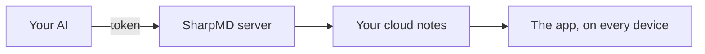

# Connect your AI over MCP

Claude, Codex or any other MCP client can read and write your cloud notes. It reads the notes of the project before a task and writes down what it did.



## Connecting it

1. Sign in to your account. See [The cloud and sharing](cloud-and-sharing.md).
2. Open **Settings** > **AI (MCP)** and create a token.
3. Copy the details right then. The token is not shown again.
4. Press **Copy instructions for your AI** and paste the message into your AI.

The address of the server is `https://sync.sharpmd.app/mcp`. The token goes as `Bearer`.

A token can be limited to one folder: your AI only sees what is in there. The MCP connection is included in the free plan, over the notes you have in the cloud.

## By client

Pick yours and copy the block.

### Claude Code

In a terminal:

```bash
claude mcp add --transport http sharpmd https://sync.sharpmd.app/mcp --header "Authorization: Bearer YOUR_TOKEN"
```

### Cursor

In `.cursor/mcp.json` in the project, or `~/.cursor/mcp.json` for all of them:

```json
{
  "mcpServers": {
    "sharpmd": {
      "url": "https://sync.sharpmd.app/mcp",
      "headers": {
        "Authorization": "Bearer YOUR_TOKEN"
      }
    }
  }
}
```

### Codex

In `~/.codex/config.toml`:

```toml
[mcp_servers.sharpmd]
url = "https://sync.sharpmd.app/mcp"
http_headers = { Authorization = "Bearer YOUR_TOKEN" }
```

### Claude Desktop

Claude Desktop reads `claude_desktop_config.json` and reaches the server through `mcp-remote`, which has to be available with `npx`:

```json
{
  "mcpServers": {
    "sharpmd": {
      "command": "npx",
      "args": [
        "-y",
        "mcp-remote",
        "https://sync.sharpmd.app/mcp",
        "--header",
        "Authorization:${SHARPMD_AUTH}"
      ],
      "env": {
        "SHARPMD_AUTH": "Bearer YOUR_TOKEN"
      }
    }
  }
}
```

### Another client

Any client that accepts an MCP server over HTTP needs two things:

- URL: `https://sync.sharpmd.app/mcp`
- Header: `Authorization: Bearer YOUR_TOKEN`

Replace `YOUR_TOKEN` with the token you created. It is a key: keep it out of notes, commits and chats.

## Rotating or revoking the token

In **Settings** > **AI (MCP)**, each token in the list has two buttons.

- **Regenerate** changes the secret and keeps the same name, folder and permissions. Connections using the old token stop working: paste the new one into your AI.
- **Revoke** deletes the token. The AI using it can no longer get in.

If a token leaks, regenerate or revoke it right away. There is no expiry date: it lasts until you change it.

## What it can do

| For | Tools |
|---|---|
| Notes | `list_notes`, `list_folders`, `read_note`, `write_note`, `append_note`, `edit_note`, `move_note`, `search_notes`, `note_history` |
| Tasks and comments | `set_task`, `list_comments`, `resolve_comment` |
| Boards | `list_boards`, `create_board`, `update_board`, `add_card`, `add_cards`, `move_card`, `update_card`, `delete_card` |
| Agents | `start_agent`, `update_agent`, `end_agent`, `list_agents` |
| Working guide | `get_guide` |

There are five more for sharing: `list_shares`, `share_note`, `unshare_note`, `create_public_link` and `revoke_public_link`. They exist only for a token created with the sharing permission, which is off by default.

Each write returns a link that opens the note in the app.

## It does not overwrite your work

`edit_note` replaces one exact passage and `set_task` checks one task, without sending the whole note. If the note changed while the AI was working, the two changes are merged line by line. If both touched the same lines, nothing is saved and the AI gets the current text back.

## Asking it for a change

Leave a comment on a block with **Comment for the AI**. The AI reads the open comments, makes the change and closes each one.

## What it does not see

> [!NOTE]
> A folder with a password is closed to the AI. You open it with **Unlock for the AI…**, for as long as you choose.

What is in the trash is not reachable over MCP either.

For flows without an AI, see [Automations and webhooks](automations.md) and the [API reference](api.md).
