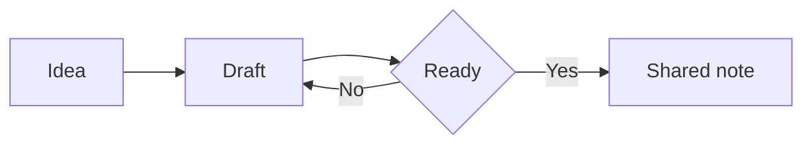
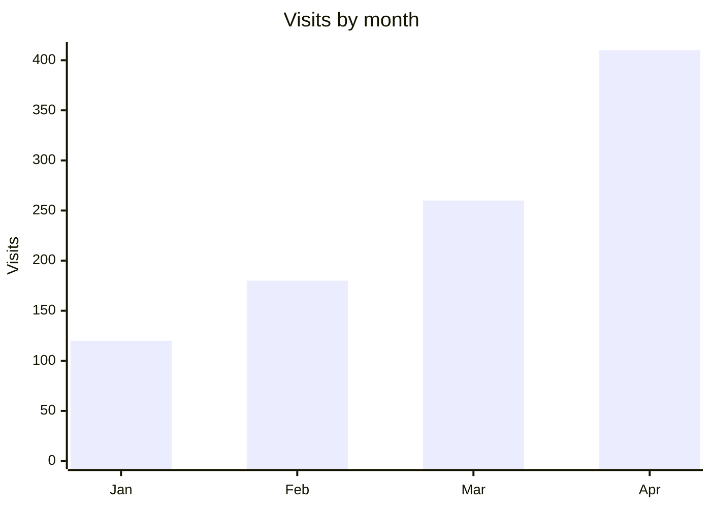

# Diagrams and formulas

## Diagrams

A diagram is a code block named `mermaid`. SharpMD draws it:



That drawing comes from this text:

````text

````

To add one, pick **Diagram** in the block menu. While editing, a click on the diagram opens its editor: the drawing next to the code, templates, pieces you add with a button and color palettes. If there is an error, it explains it and marks the line.

A `dot` block is drawn with Graphviz.

## Charts

A bar, line or pie chart is also a `mermaid` block:



To build one from a table, click a cell while editing and pick **Chart** in the table bar. You choose the type, the column with the labels and the one with the values, and the chart lands below the table. It reads numbers like `1,234.5`, `$ 900` and `12 %`, and leaves out the totals row. The table stays as it is. If you change a number later, chart it again.

## Formulas

Formulas are written in LaTeX and drawn by KaTeX. Inside a line they go between dollar signs: energy is $E = mc^2$.

In a block of their own they go between two pairs of signs:

$$
x = \frac{-b \pm \sqrt{b^2 - 4ac}}{2a}
$$

To add one, pick **Formula** in the block menu. The editor shows it as you type.

### Numbered equations

A block equation with a label at the end of its closing line gets its number on the right. To refer to it, write `@eq:id` or `\eqref{id}`: it shows as `(1)` and links to the equation. Numbers follow the order of appearance, and you can refer to an equation before writing it.

```
$$
E = mc^2
$$ {#eq:energy}

By @eq:energy, mass is energy.
```

A reference to a label that does not exist shows as `(?)`.

### Macros

If you use a symbol often, define it in the note header and write it short in every formula:

```
---
macros:
  \RR: "\mathbb{R}"
  \norm: "\left\lVert #1 \right\rVert"
---
```

## Citations and bibliography

For people who study or research. The note says where its sources come from in one of two ways: a `.bib` file next to the note, named in the header, or a `bibtex` code block inside the note itself.

```
---
bibliography: refs.bib
---
```

Then cite with `[@key]`, add a place in the source with `[@key, p. 12]`, and cite several at once with `[@one; @other]`. Each citation shows as author and year, for example `(Smith & Jones, 2020, p. 12)`, and at the end of the note a **References** section appears, sorted by author, with the cited sources.

The BibTeX reader is our own and understands the basics: `article`, `book`, `inproceedings` and `misc`, with `author`, `year`, `title`, `journal`, `publisher`, `doi` and `url`. A key that is not in the bibliography is marked in red and breaks nothing.

### Quoting a PDF

With a PDF open, select some text and tap **Quote in a note** in the viewer bar. A quote is copied with the text, the page and a `file.pdf#page=N` link that opens the PDF on that page. Paste it into your note. The PDF has to be in the same folder as the note for the link to work.

## Going further

The **Explorable diagrams** tool lets you walk through a flowchart: zoom, drag, find a node and see what reaches it. Turn it on in **Settings** > **Tools**. See [Tools and plugins](tools-and-plugins.md).

With [dictation](voice.md) you can also build formulas and diagrams by speaking.
