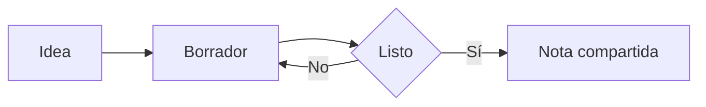
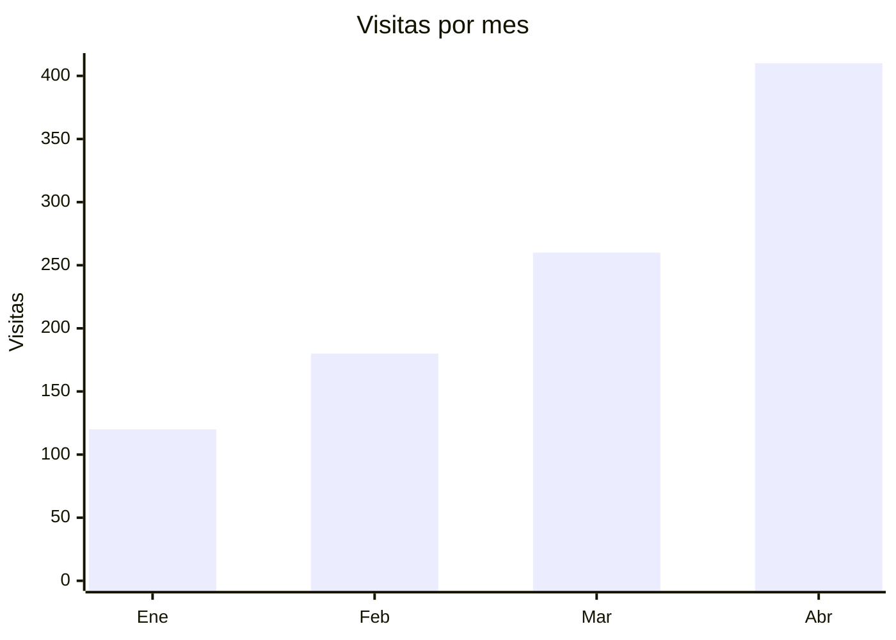

# Diagramas y fórmulas

## Diagramas

Un diagrama es un bloque de código con el nombre `mermaid`. SharpMD lo dibuja:



Ese dibujo sale de este texto:

````text

````

Para sumar uno, elegí **Diagrama** en el menú de bloques. Editando, un clic sobre el diagrama abre su editor: el dibujo al lado del código, plantillas, piezas que se agregan con un botón y paletas de color. Si hay un error, lo explica y marca el renglón.

Un bloque `dot` se dibuja con Graphviz.

## Gráficos

Un gráfico de barras, de líneas o de torta también es un bloque `mermaid`:



Para armarlo desde una tabla, entrá a una celda mientras editás y elegí **Graficar** en la barra de la tabla. Elegís el tipo, la columna de los rótulos y la de los valores, y el gráfico queda debajo de la tabla. Lee números como `1.234,5`, `$ 900` y `12 %`, y deja afuera la fila de totales. La tabla no cambia. Si después cambiás un número, graficala de nuevo.

## Fórmulas

Las fórmulas se escriben en LaTeX y las dibuja KaTeX. Dentro de un renglón van entre signos de pesos: la energía es $E = mc^2$.

En un bloque aparte van entre dos pares de signos:

$$
x = \frac{-b \pm \sqrt{b^2 - 4ac}}{2a}
$$

Para sumar una, elegí **Fórmula** en el menú de bloques. El editor la muestra mientras escribís.

### Ecuaciones numeradas

Una ecuación en bloque con una etiqueta al final del cierre lleva su número a la derecha. Para citarla, escribí `@eq:id` o `\eqref{id}`: se ve como `(1)` y lleva a la ecuación. Los números siguen el orden en que aparecen, y se puede citar una ecuación antes de escribirla.

```
$$
E = mc^2
$$ {#eq:energia}

Según @eq:energia, la masa es energía.
```

Una referencia a una etiqueta que no existe se ve como `(?)`.

### Macros

Si usás seguido un símbolo, definilo en la cabecera de la nota y escribilo corto en todas las fórmulas:

```
---
macros:
  \RR: "\mathbb{R}"
  \norma: "\left\lVert #1 \right\rVert"
---
```

## Citas y bibliografía

Para quien estudia o investiga. La nota dice de dónde salen las fuentes de una de dos maneras: con un archivo `.bib` junto a la nota, nombrado en la cabecera, o con un bloque de código `bibtex` dentro de la misma nota.

```
---
bibliography: refs.bib
---
```

Después se cita con `[@clave]`, con lugar en la fuente con `[@clave, p. 12]`, y varias a la vez con `[@uno; @otro]`. Cada cita se ve como autor y año, por ejemplo `(Pérez y Gómez, 2020, p. 12)`, y al final de la nota aparece la sección **Referencias**, ordenada por autor, con las fuentes citadas.

El lector de BibTeX es propio y entiende lo básico: `article`, `book`, `inproceedings` y `misc`, con `author`, `year`, `title`, `journal`, `publisher`, `doi` y `url`. Una clave que no está en la bibliografía queda marcada en rojo y no rompe nada.

### Citar un PDF

Con un PDF abierto, elegí un texto y tocá **Citar en una nota** en la barra del visor. Queda copiada una cita con el texto, la página y un enlace `archivo.pdf#page=N` que abre el PDF en esa página. Pegala en la nota. El PDF tiene que estar en la misma carpeta que la nota para que el enlace funcione.

## Para ir más lejos

La herramienta **Diagramas explorables** deja recorrer un diagrama de flujo: acercar, arrastrar, buscar un nodo y ver qué llega a él. Se prende en **Ajustes** > **Herramientas**. Está en [Herramientas y plugins](tools-and-plugins.md).

Con el [dictado](voice.md) también se arman fórmulas y diagramas hablando.
